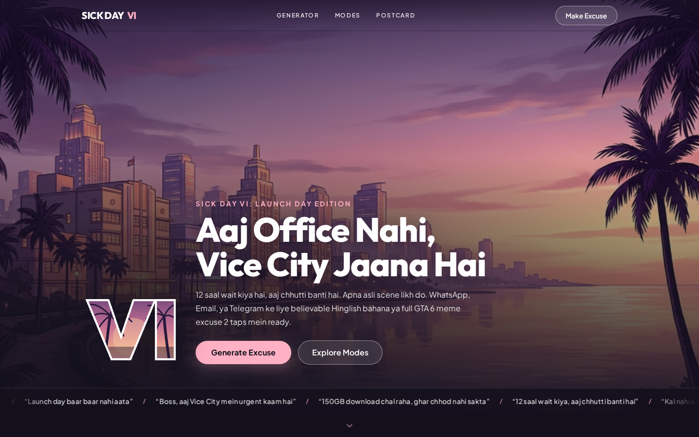
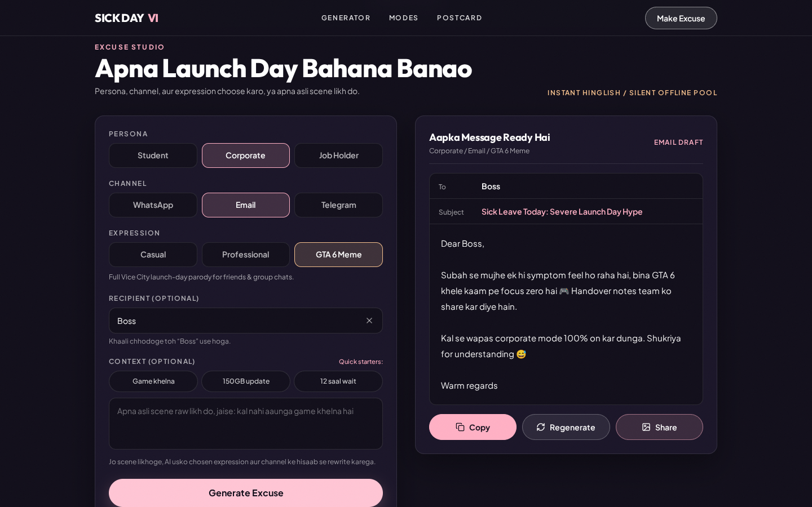
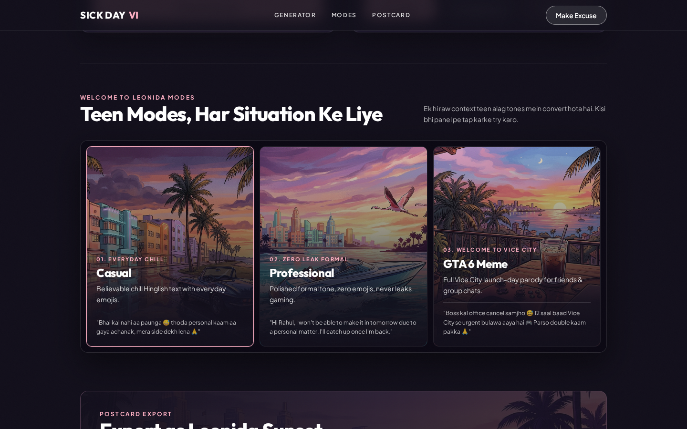
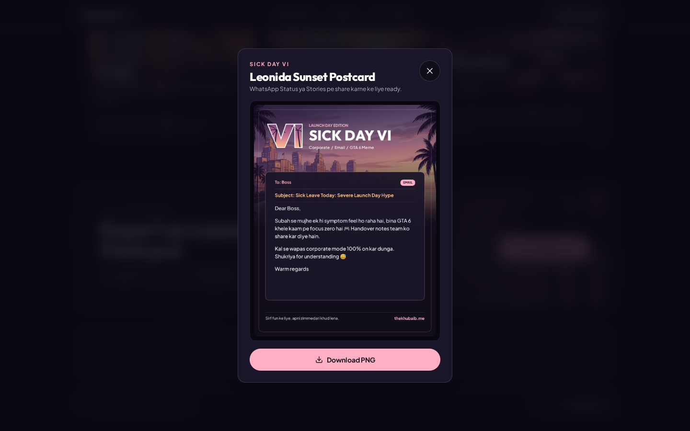
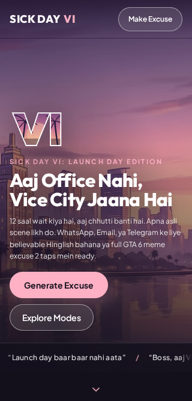
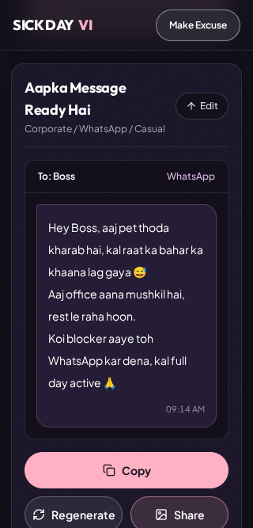
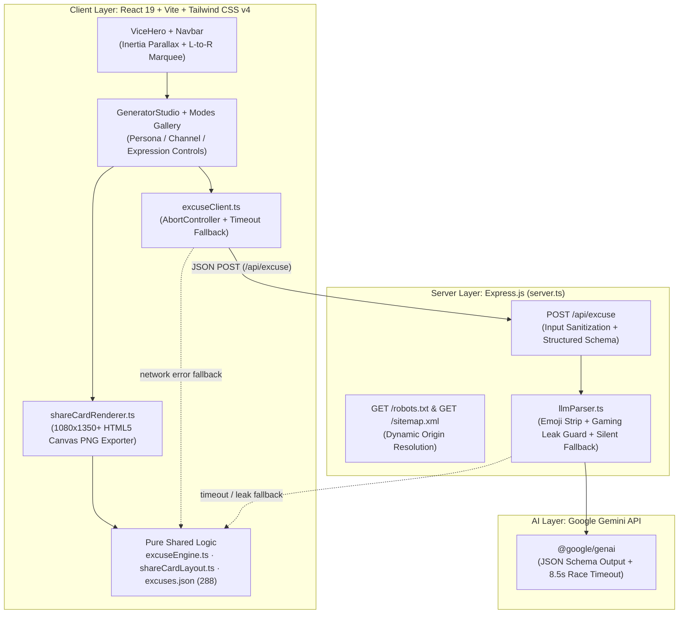
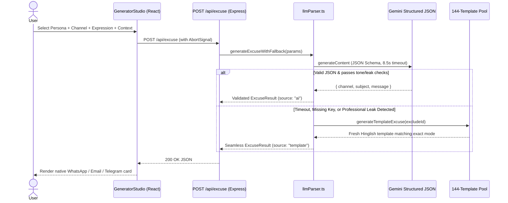

<div align="center">

  <h1>🌴 Sick Day VI (Chhutti 6): GTA 6 Hinglish Sick Day Excuse Generator</h1>

  <p>
    <strong>A full-stack, mobile-first AI Sick Leave &amp; GTA 6 Launch Day Excuse Generator for WhatsApp, Email, and Telegram, featuring Hinglish + Professional Zero-Leak modes, a 288-entry JSON-first template pool (zero API calls unless custom context is entered), and downloadable Leonida Sunset PNG Postcards.</strong>
  </p>

  <p>
    
    
    
    
    
    
    
  </p>

  <p>
    <a href="#-visual-tour">Visual Tour</a> •
    <a href="#-high-level-design-hld">High-Level Design (HLD)</a> •
    <a href="#-low-level-design-lld">Low-Level Design (LLD)</a> •
    <a href="#-seo--discoverability">SEO &amp; Discoverability</a> •
    <a href="#-getting-started">Getting Started</a> •
    <a href="#-about-me">About Me</a>
  </p>

</div>

---

## ✨ Overview

GTA 6 launch day hype is real, whether you are a college student skipping a morning lecture, a corporate developer dodging a standup, or a shift worker taking a well-earned break. Most generic AI excuse makers write stiff robotic English that immediately gives the game away.

**Sick Day VI (Chhutti 6)** solves this with a fast, witty **Hinglish Sick Day Excuse Generator** built for India and Pakistan audiences:

- **3 Tailored Personas:** Switch between **Student** (class/college/professor excuses), **Corporate** (manager/sprint/standup leave drafts), and **Job Holder** (boss/shift/duty leave messages) with persona-aware default recipients.
- **3 Native Messaging Channels:** Format excuses authentically for **WhatsApp** (casual chat bubble + timestamp), **Email** (structured `To` + `Subject` + formal sign-off), and **Telegram** (with `**bold**` markdown emphasis spans).
- **3 Expression Modes with Strict Guardrails:**
  - **Casual:** Believable, everyday Hinglish with relatable emojis.
  - **Professional:** Polished leave note with **zero emojis** and automated **zero-gaming-leak** filtering (never mentions GTA, Vice City, PS5, or gaming even if you type `"kal game khelna hai"` in your raw context).
  - **GTA 6 Meme Mode:** Full launch-day parody energy celebrating the 12-year wait and 150GB update for friends and group chats.
- **JSON-First Architecture + On-Demand AI:** Default generations serve instantaneously from a curated **288-template JSON dataset** (`src/data/excuses.json`) with **zero API calls**. When a user enters custom context, server-side Gemini structured JSON (`POST /api/excuse`, 8.5s timeout) tailors the message to that exact scene, falling back silently to JSON on any error.
- **One-Click Leonida Sunset PNG Postcard Export:** Pure client-side HTML5 Canvas renderer (`1080x1350+`) that composites original coastal sunset artwork, a geometric palm-silhouetted `VI` emblem, channel badge, wrapped Hinglish copy, and credit footer for WhatsApp Status and Instagram Stories.
- **Leonida Sunset UI & 320px Mobile Ergonomics:** Full-viewport (`100svh`) parallax hero with a clickable left-to-right funny context marquee, transparent-to-frosted navbar, thick-guttered 3-panel illustrated Mode gallery, zero horizontal scroll down to `320px`, and mobile auto-scroll to the generated preview.

---

## 📸 Visual Tour

### 1. Full-Viewport Leonida Sunset Hero & Funny Context Marquee
Original painterly coastal sunset skyline with smooth inertia parallax, geometric palm-filled `VI` emblem, blush-pink primary pill CTA, glass secondary CTA, transparent floating header, and a clickable left-to-right short Hinglish context marquee.



---

### 2. Excuse Generator Studio (WhatsApp, Email & Telegram Live Preview)
Two-column studio with 1-tap quick starters (`Game khelna`, `150GB update`, `12 saal wait`), live recipient rehydration without unnecessary API calls, native channel preview cards, and one-click Copy, Regenerate, and Share actions.



---

### 3. Framed 3-Panel Illustrated Modes Showcase
Interactive thick-guttered Leonida gallery showcasing **Casual**, **Professional**, and **GTA 6 Meme** tones with original 4:3 coastal artwork and tap-to-switch mode selection.



---

### 4. Leonida Sunset Postcard PNG Export Modal
Client-side high-resolution `1080x1350+` Canvas postcard renderer ready for direct PNG download or Web Share API sharing to WhatsApp Status and Stories.



---

### 5. Responsive Mobile Experience (`320px+` Zero Overflow)
Engineered for narrow phones with full-viewport initial framing, non-truncating control grids, full-width mobile Copy CTA, and automatic smooth scroll to the generated excuse preview.

<table>
  <tr>
    <td align="center" width="50%">
      <br/>
      <sub><strong>Mobile Hero</strong>: Full-screen fit with twin pill CTAs &amp; live marquee</sub>
    </td>
    <td align="center" width="50%">
      <br/>
      <sub><strong>Mobile Preview</strong>: Auto-scrolls to preview with Edit jump &amp; 1-tap Copy</sub>
    </td>
  </tr>
</table>

---

## 🏛 High-Level Design (HLD)

### System Architecture



### Core Architectural Decisions

| Concern | Architectural Choice | Rationale |
| :--- | :--- | :--- |
| **API Cost Efficiency & Zero-Error Reliability** | **JSON-first routing** over 288 curated Hinglish templates (`excuses.json`); Gemini API runs **only when custom context is entered** | Cuts API usage dramatically for normal browsing/regenerates while still crafting tailored AI responses whenever users write their own scene. |
| **Professional Mode Safety** | Regex emoji scrubber + gaming-leak keyword detector (`gta`, `vice city`, `ps5`, `controller`, etc.) | Prevents accidental gaming references in formal leave emails when a user types raw gaming context. |
| **Instant Recipient Editing** | Pure `rehydrateTemplateRecipient()` helper (`src/utils/excuseEngine.ts`) | Typing a boss or professor's name updates template greetings in real time with zero API latency. |
| **Stale-Response Protection** | `AbortController` + monotonic `requestCounterRef` inside `App.tsx` | Switching persona, channel, or expression mid-generation cancels obsolete requests cleanly. |
| **High-FPS Motion Without Heavy Libs** | DOM-ref `requestAnimationFrame` inertia parallax + CSS `translate3d` marquee + `IntersectionObserver` reveals | Keeps animations GPU-composited at 60fps while honoring `prefers-reduced-motion`. |
| **Search Engine Visibility** | Static + Express dynamic `robots.txt`/`sitemap.xml`, OpenGraph/Twitter meta, and Schema.org `WebApplication` + `FAQPage` JSON-LD | Ensures Google Search, WhatsApp, Discord, LinkedIn, and X render rich snippets and visual preview cards. |

---

## ⚙️ Low-Level Design (LLD)

### 1. Request, Validation & Fallback Sequence



### 2. Core Pure Logic Modules (`src/utils/`)

- **`src/utils/excuseEngine.ts`:** Deterministic template selector with non-repeating `excludeId` support, recipient rehydration, clipboard formatter (`Subject:` included only for Email), and Telegram `**bold**` span parser.
- **`src/utils/llmParser.ts`:** Builds few-shot Hinglish system/user prompts, validates JSON output against channel constraints, strips emojis in `professional` mode, rejects gaming leaks in `professional` mode, and blocks verbatim echo of raw slang.
- **`src/utils/shareCardLayout.ts`:** Pure word-wrapping engine for HTML5 Canvas supporting multi-paragraph breaks and Telegram bold runs across wrapped lines, plus clean PNG filename generation.
- **`src/utils/shareCardRenderer.ts`:** Client-side Canvas 2D exporter rendering `1080x1350+` Leonida Sunset Postcards with graceful sunset-gradient fallback if artwork fails to load.

### 3. API & SEO Route Surface (`server.ts`)

<details>
<summary><strong>Expand Endpoint Reference</strong></summary>

| Method & Route | Content-Type | Responsibility |
| :--- | :--- | :--- |
| `POST /api/excuse` | `application/json` | Validates persona/channel/expression, bypasses Gemini when context is empty, invokes Gemini with 8.5s timeout on custom context, and falls back silently to 288-template JSON pool |
| `GET /robots.txt` | `text/plain` | Dynamically outputs crawler rules and absolute `Sitemap:` URL using `APP_URL` or request host |
| `GET /sitemap.xml` | `application/xml` | Dynamically serves fresh XML sitemap with `<loc>` and `<lastmod>` for Google Search Console |

</details>

### 4. Project Structure

```text
├── docs/images/                      # README desktop & mobile showcase screenshots
├── public/
│   ├── apple-touch-icon.png          # 180x180 horizontally flipped iOS home screen icon
│   ├── assets/aistudio/              # Custom illustrated gamer mascot logo asset
│   ├── favicon.png                   # 256x256 horizontally flipped rounded PNG favicon
│   ├── og-image.jpg                  # 1280x720 OpenGraph & Twitter Card social preview image
│   ├── robots.txt                    # Static crawler directive fallback
│   └── sitemap.xml                   # Static XML sitemap fallback
├── src/
│   ├── assets/images/                # 4 original Leonida Sunset & coastal panel illustrations
│   ├── components/
│   │   ├── FaqSection.tsx            # Collapsible SEO FAQ section synced with FAQPage JSON-LD
│   │   ├── Footer.tsx                # Ad slot, Hinglish disclaimer, and creator credit
│   │   ├── GeneratorStudio.tsx       # 2-column studio, live channel preview, 3-panel Modes gallery
│   │   ├── Navbar.tsx                # Floating header with flipped mascot badge + navigation
│   │   ├── ScrollReveal.tsx          # Consistent IntersectionObserver entrance wrapper
│   │   ├── ShareModal.tsx            # PNG postcard preview modal + Download & Web Share API
│   │   ├── ViceEmblem.tsx            # Original geometric palm-filled VI SVG monogram
│   │   └── ViceHero.tsx              # Full-height parallax hero + L-to-R funny context marquee
│   ├── data/
│   │   ├── excuses.json              # 288 curated Hinglish templates (Casual, Professional, GTA 6 Meme)
│   │   └── templates.ts              # Typed JSON loader for excuses.json
│   ├── services/
│   │   └── excuseClient.ts           # JSON-first client with context-triggered AI fetch & fallback
│   ├── types/
│   │   └── excuse.ts                 # Shared TypeScript unions, options, and marquee quotes
│   └── utils/
│       ├── excuseEngine.ts           # Pure template engine + Telegram parser + unit tests
│       ├── llmParser.ts              # Gemini prompt builder + leak guard + unit tests
│       ├── seoMeta.ts                # Duplicate-free SEO head tag synchronizer + unit tests
│       ├── shareCardLayout.ts        # Pure Canvas line-wrapping helper + unit tests
│       └── shareCardRenderer.ts      # HTML5 Canvas Leonida Sunset PNG postcard renderer
├── index.html                        # Full SEO meta tags, OpenGraph, Twitter Card, JSON-LD
├── server.ts                         # Express API proxy, dynamic robots/sitemap, Vite dev server
└── vite.config.ts                    # Vite 8 + React + Tailwind CSS v4 configuration
```

---

## 🔍 SEO & Discoverability

This project is pre-configured for **Google Search**, **GitHub Search**, and rich social link previews:

- **On-Page Meta & Social Cards (`index.html`):** Keyword-targeted `<title>`, 155-character meta description, `<meta name="keywords">`, OpenGraph (`og:title`, `og:description`, `og:image`), Twitter `summary_large_image` card, and runtime canonical URL synchronization in `src/App.tsx`.
- **Schema.org Rich Snippets:** Embedded `@graph` JSON-LD declaring both `WebApplication` (free tool metadata + feature list + author) and `FAQPage` (matching the visible `<FaqSection />` accordion for Google Rich Results eligibility).
- **Crawlability:** Dynamic `/robots.txt` and `/sitemap.xml` routes in `server.ts` plus static fallbacks in `public/`.

### Recommended GitHub Repository SEO Settings

To maximize discovery on GitHub and Google, add these in **Repository → About (gear icon)**:

- **Description:** `GTA 6 Hinglish Sick Day Excuse Generator for WhatsApp, Email & Telegram. Built with React 19, TypeScript, Tailwind CSS v4, Express, Gemini AI & Canvas PNG Postcard export.`
- **GitHub Topics:** `gta6`, `gta-vi`, `excuse-generator`, `sick-day-generator`, `hinglish`, `ai-excuse-maker`, `whatsapp-message-generator`, `react-19`, `typescript`, `tailwindcss-v4`, `gemini-api`, `express`, `html5-canvas`, `seo-friendly`, `meme-generator`

---

## 🚀 Getting Started

### Prerequisites

- **Node.js** `20+`
- Optional: A **Google Gemini API Key** for live AI rewriting of custom user contexts (the app works out-of-the-box without a key using its 144-template Hinglish pool).

### 1. Clone & Install

```bash
git clone https://github.com/Khubaib-shah/sick-day-vi.git
cd sick-day-vi
npm install
```

### 2. Configure Environment Variables

Copy `.env.example` to `.env`:

```env
APP_URL="http://localhost:3000"
GEMINI_API_KEY="your-gemini-api-key-optional"
```

### 3. Run Locally

```bash
npm run dev
```

Open `http://localhost:3000` in your browser.

### 4. Verify Build, Types & Unit Tests

```bash
# TypeScript strict check
npm run lint

# Run all 18 pure-logic unit tests (templates, leak guard, Canvas line wrapping)
npx tsx --test src/utils/excuseEngine.test.ts src/utils/llmParser.test.ts src/utils/shareCardLayout.test.ts

# Production build & start
npm run build
npm start
```

---

## 👨‍💻 About Me

Hi, I'm **Khubaib Shah** ([thekhubaib.me](https://thekhubaib.me) | `syedkhubaibshah@icloud.com`), a software engineer focused on building fast, visually memorable full-stack web applications with clean architecture and mobile-first ergonomics.

While building **Sick Day VI**, my focus was combining cultural Hinglish humor with production-grade frontend craft:

- Designing a **zero-failure AI + offline fallback architecture** backed by automated unit tests and strict tone/leak guardrails.
- Crafting a **Leonida Sunset visual system**, smooth inertia parallax, HTML5 Canvas postcard exports, and full technical SEO (`JSON-LD`, OpenGraph, `robots.txt`, and `sitemap.xml`).

If you'd like to collaborate, discuss full-stack architecture, or customize this project, feel free to reach out at **syedkhubaibshah@icloud.com** or visit **[thekhubaib.me](https://thekhubaib.me)**.
